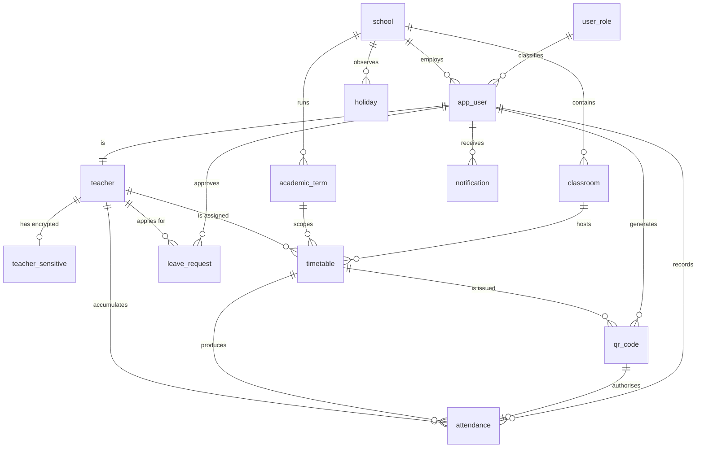

# SCAS — Database Design

Companion to [`database/01_schema.sql`](../database/01_schema.sql). This
document explains *why* the schema looks the way it does; the SQL file is the
authority on *what* it is.

---

## 1. Entity–relationship model



Read the spine of the model as one sentence:

> A **school** runs an **academic term**; within that term a **timetable** entry
> puts one **teacher** in one **classroom** at one time on one weekday; for each
> occurrence of that entry a **QR code** is issued for a specific date; scanning
> that code produces exactly one **attendance** row.

Everything else hangs off that spine: `leave_request` explains an absence,
`holiday` suppresses one, `notification` reports one, and `audit_log` remembers
who changed what.

### The tables

| Table | Rows | Purpose |
|-------|------|---------|
| `school` | 2 | Tenant root. Every row in the system reaches a school through some path. |
| `user_role` | 4 | Teacher, Headteacher, School Administrator, System Administrator. |
| `app_user` | 20 | Authentication and authorization. Holds the bcrypt hash and lockout state. |
| `teacher` | 16 | Employment facts. One-to-one with `app_user` for staff who teach. |
| `teacher_sensitive` | 0 | Ghana Card number, bank account, next of kin — **AES-256 encrypted**, split from `teacher` so the grant boundary is a table boundary. |
| `classroom` | 12 | Rooms, with capacity. |
| `academic_term` | 3 | Term dates. Exactly one may be current per school. |
| `holiday` | 6 | Days on which absence must not be recorded. |
| `timetable` | 80 | The recurring assignment: teacher × classroom × weekday × period. |
| `qr_code` | 1045 | One token per timetable entry per date. Carries validity window, single-use counter and revocation. |
| `attendance` | 1093 | The live ledger. InnoDB with 4 foreign keys; **not** partitioned (see §4). |
| `attendance_archive` | 84 | Cold storage, **RANGE partitioned by year**, no FKs (see §4). |
| `attendance_daily_summary` | 1093 | Materialised per-teacher-per-day rollup, refreshed hourly. |
| `leave_request` | 7 | Application, approval, and the link that turns Absent into Excused. |
| `notification` | 11 | Outbound messages, written by triggers. |
| `audit_log` | 2384 | Append-only. Who changed which column, from what, to what. |
| `security_event` | 33 | Sign-ins, lockouts, permission denials, scan rejections. |
| `backup_log` | 1 | Backup and restore history; feeds the recovery dashboard. |
| `query_performance_log` | 5 | Measured plans from `11_query_processing_evaluation.sql`. |
| `system_setting` | — | Configuration. **System-versioned** — see §5. |

---

## 2. Normalisation

The schema is in **Boyce–Codd normal form**, with two deliberate, documented
departures. Working through the interesting cases:

**`timetable` — why the composite key is what it is.**
A room cannot host two classes at once, and a teacher cannot be in two rooms at
once. Those are two different functional dependencies:

```
(classroom_id, term_id, day_of_week, start_time) → teacher_id, subject
(teacher_id,   term_id, day_of_week, start_time) → classroom_id, subject
```

Both determinants are candidate keys, so BCNF requires both to be enforced as
keys. They are, as `uk_timetable_room` and `uk_timetable_teacher`.
A single surrogate `timetable_id` with one unique constraint would have left the
double-booking of a teacher representable — the classic BCNF violation, and here
a real one: it would let a teacher be marked present in two rooms simultaneously.

**`attendance` — why `session_date` is stored even though it is derivable.**
`qr_code_id → session_date` holds, so storing `session_date` on `attendance` is
a transitive dependency and a 3NF violation. It is stored anyway for three
reasons that a join could not provide:

1. `uk_attendance_session (timetable_id, session_date, teacher_id)` — the
   constraint that makes a second check-in for the same session impossible.
   A unique key can only be built from columns physically in the table.
2. `ix_att_date_status (session_date, status)` covers the reporting queries
   entirely, so `COUNT(*)` by month never touches the table or the `qr_code`
   table at all.
3. It is the partitioning key of `attendance_archive`, which rows are copied
   into unchanged.

Denormalising is only safe if the derived copy cannot drift, so
`trg_attendance_bi` **overwrites** whatever the caller supplied with the value
read from the QR code, and `sp_run_integrity_check` re-tests the equality on
every run. The dependency is enforced by construction rather than by
convention.

**`attendance_daily_summary` — a materialised aggregate.**
Fully derivable from `attendance`, and therefore redundant by definition. It
exists because the headteacher's dashboard aggregates a term of data on every
page load. Refreshed hourly by `ev_refresh_summary`, and rebuilt from
source by `sp_refresh_attendance_summary`, so it can never be the only copy of
anything.

**`teacher_sensitive` — a vertical partition, not a normalisation artefact.**
It is 1:1 with `teacher` and could be folded in. It is separate so that
"who may read a Ghana Card number" is expressible as a table-level grant. Column
grants exist, but a separate table is harder to get wrong and survives
`SELECT *`.

Everything else is in BCNF with no exceptions: no repeating groups, no partial
dependencies on composite keys, no transitive dependencies through non-keys.

---

## 3. Domain integrity

22 `CHECK` constraints, 19 foreign keys, 17 unique constraints. The principle
is that **anything expressible as a constraint is a constraint**, because
constraints hold against every route into the database — the application, the
DBA console, phpMyAdmin, a mistaken `UPDATE` at the command line.

Representative examples:

| Constraint | Definition | Prevents |
|-----------|-----------|----------|
| `ck_attendance_qr_required` | `status IN ('Absent','Excused') OR qr_code_id IS NOT NULL` | A row claiming attendance with no QR code behind it |
| `ck_attendance_late` | `minutes_late BETWEEN 0 AND 1440` | Negative lateness, or a value outside a day |
| `ck_qr_window` | `expiry_datetime > generated_datetime` | A code born already expired |
| `ck_qr_max_scans` | `max_scans BETWEEN 1 AND 100` | A code configured to allow zero or unlimited scans |
| `ck_leave_dates` | `end_date >= start_date` | Leave that ends before it starts |
| `ck_term_dates` | `end_date > start_date` | A term ending before it starts |
| `ck_school_name_len` | `CHAR_LENGTH(TRIM(school_name)) >= 3` | Blank or single-character school names |

`ck_attendance_qr_required` is the load-bearing one: `Present` and `Late` are
unrepresentable without a `qr_code_id`, so "present by scan, with no scan" is
excluded by the data model rather than merely discouraged. Only `Absent` and
`Excused` — the two statuses nobody forges in their own favour — may exist
without a code.

**What a `CHECK` cannot do here.** `ck_qr_max_scans` bounds the *column*; it
does not stop a code being scanned twice, because a `CHECK` cannot compare a row
against a concurrent transaction. Single-use is therefore enforced where it has
to be — `SELECT ... FOR UPDATE` inside `sp_record_attendance` — and
`sp_run_integrity_check` then re-tests `scan_count <= max_scans` across the whole
table as a detective control. Prevention and detection are separate mechanisms,
and it is worth being clear about which one a given object provides.

Foreign keys use `ON DELETE RESTRICT` on the ledger path (`attendance`,
`qr_code`) and `ON DELETE CASCADE` only where the child is genuinely part of the
parent (`teacher_sensitive`, `notification`). Attendance history must survive a
teacher record being tidied up; that is the difference between a ledger and a
cache.

---

## 4. Physical design

**Partitioning — and why it is on the archive, not the ledger.**
InnoDB cannot combine partitioning with foreign keys: a partitioned table can
have neither outgoing nor incoming FK constraints. That forces a choice, and the
two tables are on opposite sides of it deliberately:

| | `attendance` (hot) | `attendance_archive` (cold) |
|---|---|---|
| Partitioned | **No** | **Yes** — `RANGE (YEAR(session_date))` |
| Foreign keys | **4** — teacher, timetable, qr_code, recorded_by | **None** |
| Why | Live check-ins must be referentially bound to a real teacher, a real session and a real QR code. Losing that is unacceptable for the working ledger. | Rows are already validated and immutable. Their integrity was proved on the way in, so the FKs have no further work to do — and their absence buys partitioning. |

`attendance_archive` carries `p2023`…`p2026` plus a `pmax` catch-all. Retention
then becomes `ALTER TABLE ... DROP PARTITION`, which is instantaneous, rather
than a `DELETE` that would rewrite the table and bloat the undo log.

Pruning verified on the live database:

```
EXPLAIN PARTITIONS SELECT COUNT(*) FROM attendance_archive
WHERE session_date >= '2026-01-01' AND session_date < '2027-01-01';

partitions: p2026        <- only one partition touched, not five
rows: 80     Extra: Using where; Using index
```

`sp_archive_old_attendance` is the only thing that moves rows across the
boundary, and it copies into the archive *before* it is permitted to delete from
the ledger — the delete trigger refuses unless that has happened.

**Index strategy.** Composite indexes are ordered *equality columns first, then
the range column, then columns needed only for covering*. `ix_att_date_status`
on `(session_date, status)` supports both the range scan and the status filter,
and covers `COUNT(*)` queries entirely — the plans in §4 of the README show
`Using index`, meaning the table itself is never touched.

**Storage.** InnoDB throughout, `utf8mb4_unicode_ci`, for row-level locking,
foreign keys and crash recovery. `ROW_FORMAT=DYNAMIC` on the wide tables.

---

## 5. The temporal table

`system_setting` is declared `WITH SYSTEM VERSIONING`. MariaDB then keeps every
superseded version of every row automatically, and they are queryable:

```sql
SELECT setting_key, setting_value
FROM   system_setting FOR SYSTEM_TIME AS OF TIMESTAMP '2026-08-01 08:00:00';
```

This is a recovery mechanism, and the reason it earns its place is the failure
it addresses. Someone changes `late_threshold_minutes` from 10 to 30; nobody
notices for a week; the month's lateness figures are quietly wrong. Recovering
the old value from a `mysqldump` means restoring a 1.2 MB backup somewhere to
read one integer. Here it is one query, with no downtime and no restore — and
the same query proves *when* it changed and what it was before.

---

## 6. Design decisions worth defending

**Why the QR token is 32 hex characters and random, not a hash of the session.**
A derivable token can be forged by anyone who knows the derivation. These come
from `RANDOM_BYTES(16)`, so possession of the token is evidence of having seen
the code. Uniqueness is enforced by a unique index rather than assumed from the
entropy.

**Why single-use is enforced with `SELECT ... FOR UPDATE` and not `UPDATE ...
WHERE scan_count < max_scans`.** The single-statement form would in fact be
atomic. The row lock is used because the procedure must *also* read the code's
validity window, owner and revocation state, and decide between four different
rejection reasons, before writing. Holding the lock across that read-decide-write
sequence is what makes the decision and the write consistent with each other.
The `CHECK` constraint remains as a backstop.

**Why attendance rows are only partly immutable.** A blanket ban would be the
wrong rule, because a verdict legitimately changes: leave gets approved after
the fact and an `Absent` must become `Excused`. So the line is drawn between
*evidence* and *verdict*. `trg_attendance_bu` freezes the evidence —
`teacher_id`, `timetable_id`, `session_date`, `scan_datetime`, `qr_code_id` —
for every account including `root`. `status`, `minutes_late` and `remarks` stay
editable, and `trg_attendance_au` writes every one of those changes to
`audit_log`, so a verdict can change but never quietly. `trg_attendance_bd`
refuses deletes altogether, except for `sp_archive_old_attendance`, which sets a
session flag only after proving the rows are already in `attendance_archive`.

The result: you cannot alter who was present, when, or under whose code; you can
correct the judgement about it, and the correction is always visible. A register
that can be silently edited is the paper problem reproduced in software; one that
can never be corrected is unusable in a real school.

**Why the application cannot write.** Discussed in
[SECURITY.md](SECURITY.md) — but the design consequence is that every write path
had to be named and enumerated up front, which is why there are 42 procedures.
That is a feature: the complete list of things the system can do to itself is
`SHOW PROCEDURE STATUS`.
